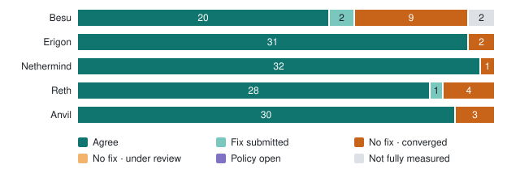

# Trace API: what would change?

The clients already share much of the `trace_*` API. These reports show where adopting the [draft specification](https://github.com/banteg/execution-apis/tree/794b655decb8980df6f02427f7e99a225d9eb46d) would change their behavior. Start with your client, then use the examples and source links to review a proposed change.

Published builds checked at **2026-11-25T15:07:31.009461+00:00**. [Freshness preflight](../evidence/2026-11-25/eval/preflight.json) · [Build lock](../evidence/2026-11-25/eval/clients.lock.json). All corpora use this snapshot; later upstream changes require a new capture.

For verdicts that changed since the last capture, see [changes since the previous matrix](changes.md).

## Progress

Across the Besu, Erigon, Nethermind, Reth and Anvil development builds, **141 of 165** client decisions agree with the draft (+8 since the previous capture). 3 more have a submitted fix, and **19 differ with no fix yet**: 19 on converged decisions and 0 on decisions still under review. 9 agreements are in development builds but not yet in a stable release.

| Client | Build | ✅ Agree | 🛠️ Fix submitted | ⚠️ No fix · converged | ⚠️ No fix · under review | ❔ Policy open | ⚪ Not fully measured | In dev, not stable | Fix PRs merged / open |
| --- | --- | --- | --- | --- | --- | --- | --- | --- | --- |
| [Besu](clients/besu.md) | 26.11-develop · f58f40e2 | 20 (+5) | 2 | 9 | 0 | 0 | 2 | 1 | 19 / 5 |
| [Erigon](clients/erigon.md) | 3.9.0-dev · e91aca7f | 31 (-1) | 0 | 2 | 0 | 0 | 0 | 0 | 27 / 1 |
| [Nethermind](clients/nethermind.md) | 2.4.0-preview · e2f069a6 | 32 (-1) | 0 | 1 | 0 | 0 | 0 | 5 | 51 / 0 |
| [Reth](clients/reth.md) | 2.11.0 · 7f5e740c | 28 (+3) | 1 | 4 | 0 | 0 | 0 | 3 | 25 / 8 |
| [Anvil](clients/anvil.md) | 1.10.1-nightly · 50d75f19 | 30 (+2) | 0 | 3 | 0 | 0 | 0 | 0 | 16 / 0 |

Each client has one outcome per decision on its development build. A difference with no submitted fix is the rough measure of pending work; one decision can need several changes, and a PR can cover part of a decision or several. “Converged” and “under review” refer to the decision’s policy status. “In dev, not stable” counts agreements that the stable release does not share yet. Fix PRs are upstream PRs attributed to the client, including its libraries; closed PRs are excluded. The Geth draft fork implements the proposal and is not counted. Anvil, Foundry’s development node, is captured by replaying the fixture chains, so its fork-transition and reorg scenarios stay unmeasured. [Status key](technical.md#test-status-key) · [Policy status](../decisions/README.md#status-key)

## Start with your client

| Client | Main review areas |
| --- | --- |
| [Anvil](clients/anvil.md) | Foundry’s development node, captured by replaying each chain instead of through Hive. Foundry 1.8.5 · 51a52c59 shipped ten trace-interop fixes (#17301–#17304, #17306, #17307, #17309–#17312): tree-path trace_get, missing blocks and replays, replay transaction hashes, mined traces without nested precompile frames, EIP-3607 rejection for signed raw transactions, conflicting call fields, pending in block trace methods, and the fee-free, cap-only and omitted-gas call environment. With revm-inspectors 0.44.1 (#17226) it also carries the reverted-CREATE results, failure labels and vmTrace fixes. 1.8.6 · 6bad0a66 carried the same fixes and agreed on 18 decisions; it accepted integer trace_get indices, executed calls priced below the base fee and could not set a parent beacon root, so the mined-probes chain was not replayed on it. 1.9.0 · 6056c584 added #17305, #17308, #17419 (by figtracer) and #17777, the draft's pinned -32001 for an unknown block (H06): it replayed mined-probes and agreed on 28 decisions. 1.10.0 · 083e2299 and the nightly 1.10.1-nightly · 50d75f19 replace revm and revm-inspectors with evm2 and take Alloy 2.6.1: the post-Cancun self-destruct-to-self payload is reported (H23, H26) and null filter address lists are omitted (H04, Alloy #4257). Both agree on 30 decisions. With evm2 they share Reth’s vmTrace CREATE cost, which leaves out the forwarded gas (H20, evm2 #876); they still lack the trace_filter block tags (H32, Alloy #4442), and they parse the trace_filter blockHash member but ignore it (H33). |
| [Besu](clients/besu.md) | Start with failed-frame reporting, precompile output and inclusion, and range-filter consistency. Individual replay also needs a scope decision. 26.10.0 · 976ca7ea and 26.10.1 · e83703cd, which only unschedules Amsterdam on Hoodi, ship what the October 11 development build carried: it runs unsigned calls like eth_call (#11404), returns rejected trace_callMany bundles as one JSON-RPC error (#11401), starts each trace_callMany call at a transaction boundary (#11365), reports each rejected item with its own reason (#11432) and selects exactly the hashed block in trace_filter (#11407). It and the development build also return null for an unknown transaction hash (#11379) and Block not found for an unknown block (#11381). 26.10.2 · d3e1aea7 added the trace_filter mode member (#11436, H03) and the omitted trace_callMany block (#11440, H31); 26.11.0 · 0e595f9e shipped the same trace changes and agreed on 8 decisions. 26.11.2 · 09b9e94d adds trace_replayTransaction (#11406, H01), so the replay cases of H07, H08, H18 and H19 run and agree, rejects malformed trace_filter members and legacy calls for another chain (#11439), resolves safe and finalized trace_filter bounds while rejecting pending (#11441, H32), keeps failures local to their frame (#11345, H24), retains precompile output (#11346, H22) and nonzero-value precompile frames (#11360), reports empty code for self-destructing creations (#11362, H26) and creationMethod on every create frame (#11435, H10). It agrees on 19 decisions. It ignores trailing trace_call parameters, so positional state and block overrides run on unmodified state (H15) and an account override with both state and stateDiff is accepted (H14). 26.11-develop · f58f40e2 rejects those parameters and also retains root precompile halt reasons (#11347): it agrees on 20 decisions. |
| [Erigon](clients/erigon.md) | The development build agrees on tree lookup, default filter composition, MCOPY, historical system state including trace_callMany, the genesis reward, omitted trace_filter bounds (#24341), reverted-CREATE results and failure labels (#24355, #24356) and failed-CREATE filter matching, several of which still differ in 3.7.0. Since #24330 and #24343 its trace_call prices gas like eth_call, keeps the block GASLIMIT and returns the eth_simulateV1 codes. It validates signed transactions at the selected state (#24329) rejecting each for its own violation (with -32000; the error-group codes are recommended); a filter bound past the head still returns [] (#24357 is open) and vmTrace still keeps halted-operation details (#24344 is open). Since #24032, 3.8.0-dev · 5b452f41 keeps safe and finalized hashes from a same-head forkchoice update, so the reorg scenario runs and H33 agrees, and #24706 rejects an unknown trace_filter member. Its one remaining difference was a call with maxFeePerBlobGas and no blob hashes, which ran with the cap ignored (H14). #24990 rejects it. When the draft then pinned forms it had left open for exact fixtures (5e6717fe), #25030 followed: reward records with null transaction fields (H05), -32001 for an unknown trace_call block (H06) and no vmTrace idx (H21). 3.9.0-dev · cf91acee agreed on 32 decisions, and the 3.8.1 · cf6f1413 release on 29. 3.9.0-dev · e91aca7f and the 3.8.2 · 8a3f3b2c release, which now reports the forms #25030 pinned (H05, H06, H21), agree on 31. Before Cancun both reject a call with an empty blobVersionedHashes list as an inactive blob feature (-32000, “BlobTx transactions require Cancun”) instead of for the field combination, which takes precedence, and both accept an account override with both state and stateDiff (H14). Both decode a positional state override map into an empty configuration, so trace_call and trace_callMany run on unmodified state without an error (H15); #26785, by lupin012, applies the map. |
| [Geth draft fork](clients/geth.md) | The experimental fork follows the adopted source-review stances. edbd5f17 is the #35791 rework for review (the capture as a registered parityTracer, StateAtTransaction replays, --rpc.evmtimeout calls), rebased on master with the DAO fork applied in pre-execution (#36036), EIP-8024 stack effects traced and Amsterdam execution and state gas reported through the EIP-8037 hooks (#35970); its checked cases agree on all 33 decisions, including positional state and block overrides in trace_call and trace_callMany, pending simulations and pending block traces, which it runs in a real pending environment that holds pooled transactions; one H14 input policy is open, and it rejects the H12 raw-transaction block argument, an extension outside the baseline. It is not upstream Geth support or a consensus vote. Filtering remains a bounded scan; pruning still needs runtime coverage. |
| [Nethermind](clients/nethermind.md) | 2.2.2 · be201120, like 2.2.1, agrees on filter modes and empty address lists (#13857), post-merge and genesis reward records (#13938, #13783, #13801), vmTrace steps (#13940, #13958), precheck and collision frames (#13957), failed-frame results and labels (#13981) and null for a missing transaction or replay (#13937, #14037). It also validates trace_rawTransaction as block inclusion does (#14091), rejects disagreeing data and input (#14089), rejects block-hash filter bounds and selects one block with the trace_filter blockHash member (#14111), runs blob calls without a positive blob fee cap at BLOBBASEFEE 0 (#14092) and answers rejected calls with the eth_simulateV1 codes (#14158). It agrees on 27 decisions. Its release branch was cut before #14212 and #14663, so an explicit type still adds requirements, fields a call’s fork lacks run, a lone maxFeePerBlobGas is ignored, and an account override with both state and stateDiff is accepted (H14). Master includes both, and #14888 adds the forms the draft pinned for exact fixtures (5e6717fe): result null on halted frames, rewards and SELFDESTRUCT records (H09), null reward transaction fields (H05), vmTrace op (H21) and -32001 for an unknown block (H06). With #15017, a noncanonical trace_filter blockHash also returns -32001 (H33), so 2.3.0-preview · 4079edfa agreed on all 33 decisions. 2.4.0-preview · e2f069a6 agrees on 32: it runs a trace_call whose `data` and `input` disagree, executing `input`, which #14089 had rejected (H14). A code sender’s rejection message, gas-defaulting probes its funds cannot cover and the legacy-priced authorization list remain unassessed or open. |
| [Reth](clients/reth.md) | Reth 2.9.0 · c9a780f4 replaced revm and revm-inspectors with evm2 (#25002), whose Parity tracer carries ports of the revm-inspectors fixes. 2.10.1 · 58ebce14 and the nightly 2.10.1 · 5efe80f5 agreed on 25 decisions, as 2.9.0 and 2.8.1 · d763342f did, but not the same 25 as 2.8.1: evm2 reports the post-Cancun SELFDESTRUCT payload, so account deletion agrees (H26) without revm #3833, while vmTrace CALL and CREATE steps lost the forwarded gas from `cost` (H20). 2.11.0 · b9abbcc1 and the nightly 2.11.0 · 7f5e740c take evm2 past #744, so CALL costs include the forwarded gas again; a CREATE still leaves it out, which evm2 #876 fixes. The nightly also pins Alloy 2.6.0 (#4257, #4274), so null filter address lists are omitted (H04) and trace_filter selects the blockHash block (H33): it agrees on 28 decisions, the release on 25. Both ignore trace_callMany’s third and fourth parameters, so positional state and block overrides run on unmodified state (H15); trace_call applies them. Reth 2.8.0 · 05ba4812, with revm-inspectors 0.44.1 (#27668), had added the reverted-CREATE results, failure labels and vmTrace fixes (H09, H20) to what 2.7.0 shipped: tree-path lookup, default filter intersection, missing-replay nulls, replay transaction hashes, the genesis reward, omitted filter bounds, the omitted trace_callMany block, new-account stateDiff markers, EIP-7702 code changes and executing initcode in vmTrace. Remaining work includes simulation fees, trace_callMany overrides and the evm2 vmTrace CREATE cost. |

## Decisions to review

The largest API choices are [tree-path lookup](decisions/H02.md), [address-filter composition](decisions/H03.md), and [failed-frame results](decisions/H09.md). Other rows concern missing information or inconsistent execution/reporting. All recommendations remain proposals for client review.

| Question | Status | Proposed behavior |
| --- | --- | --- |
| [How does trace_get select a frame?](decisions/H02.md) | 🤝 Converged | Follow one tree path; return one object or null. An empty path selects the root. |
| [How do address filters combine?](decisions/H03.md) | 🤝 Converged | OR within each list, AND between sender and recipient lists. |
| [Where does an unbounded filter start?](decisions/H30.md) | ✅ Harmonized · stable | Default both omitted bounds to latest; historical searches specify fromBlock. |
| [What block does trace_callMany use by default?](decisions/H31.md) | ✅ Harmonized · stable | Accept an omitted block and use latest, matching trace_call. |
| [Which tags and pending state can trace methods use?](decisions/H32.md) | 🤝 Converged | Resolve mined-block tags; agree pending state and localization per method. |
| [What survives a failed call?](decisions/H09.md) | 🤝 Converged | Keep the error on that frame and preserve revert bytes and measured gas when available. |
| [Which precompile frames are visible?](decisions/H29.md) | 🤝 Converged | Keep root frames and nested frames with nonzero value; omit zero-value nested frames. |
| [Signed transaction execution validity](decisions/H13.md) | 🤝 Converged | Validate against the selected state, including nonce, funds and gas. Keep pool policies separate; reject each invalid transaction for its own violation. |

[Status definitions](../decisions/README.md#status-key). Policy direction is distinct from verified implementation on the captured builds.

[All decisions](../decisions/README.md) · [Method availability](decisions/H01.md)

[Client fixes](../docs/client-fixes.md) · [Client source guide](sources.md) · [Run a case](../docs/usage.md) · [Builds, coverage and raw results](technical.md) · [Consistency laws](laws.md) · [Spec decision tables](spec-tables.md) · [Standardization discussion](https://github.com/ethereum/execution-apis/issues/890)
