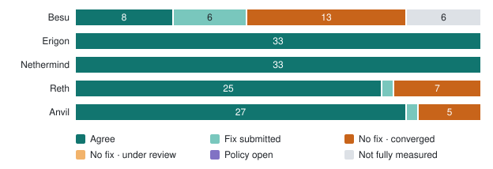

# Trace API: what would change?

The clients already share much of the `trace_*` API. These reports show where adopting the [draft specification](https://github.com/banteg/execution-apis/tree/28a5824023fbd76ef4e1dec9564b94be5883fbc1) would change their behavior. Start with your client, then use the examples and source links to review a proposed change.

Published builds checked at **2026-10-23T15:49:32.883363+00:00**. [Freshness preflight](../evidence/2026-10-23/eval/preflight.json) · [Build lock](../evidence/2026-10-23/eval/clients.lock.json). All corpora use this snapshot; later upstream changes require a new capture.

The Reth development build (built 2026-10-22 01:34 UTC) predates its v2.8.1 release build (2026-10-23 10:37 UTC), so it tests an earlier revision than that release.

For verdicts that changed since the last capture, see [changes since the previous matrix](changes.md).

## Progress

Across the Besu, Erigon, Nethermind, Reth and Anvil development builds, **126 of 165** client decisions agree with the draft (+1 since the previous capture). 7 more have a submitted fix, and **26 differ with no fix yet**: 26 on converged decisions and 0 on decisions still under review. 21 agreements are in development builds but not yet in a stable release.

| Client | Build | ✅ Agree | 🛠️ Fix submitted | ⚠️ No fix · converged | ⚠️ No fix · under review | ❔ Policy open | ⚪ Not fully measured | In dev, not stable | Fix PRs merged / open |
| --- | --- | --- | --- | --- | --- | --- | --- | --- | --- |
| [Besu](clients/besu.md) | 26.10-develop · 781a7e1d | 8 | 6 | 13 | 0 | 0 | 6 | 2 | 9 / 15 |
| [Erigon](clients/erigon.md) | 3.9.0-dev · 598ba625 | 33 | 0 | 0 | 0 | 0 | 0 | 4 | 26 / 0 |
| [Nethermind](clients/nethermind.md) | 2.3.0-preview · 7192e7f3 | 33 (+1) | 0 | 0 | 0 | 0 | 0 | 6 | 51 / 0 |
| [Reth](clients/reth.md) | 2.8.0 · 53bf066f | 25 | 1 | 7 | 0 | 0 | 0 | 0 | 24 / 8 |
| [Anvil](clients/anvil.md) | 1.8.7-nightly · 4e8874b2 | 27 | 0 | 6 | 0 | 0 | 0 | 9 | 15 / 0 |

Each client has one outcome per decision on its development build. A difference with no submitted fix is the rough measure of pending work; one decision can need several changes, and a PR can cover part of a decision or several. “Converged” and “under review” refer to the decision’s policy status. “In dev, not stable” counts agreements that the stable release does not share yet. Fix PRs are upstream PRs attributed to the client, including its libraries; closed PRs are excluded. The Geth draft fork implements the proposal and is not counted. Anvil, Foundry’s development node, is captured by replaying the fixture chains, so its fork-transition and reorg scenarios stay unmeasured. [Status key](technical.md#test-status-key) · [Policy status](../decisions/README.md#status-key)

## Start with your client

| Client | Main review areas |
| --- | --- |
| [Anvil](clients/anvil.md) | Foundry’s development node, captured by replaying each chain instead of through Hive. Foundry 1.8.5 · 51a52c59 shipped ten trace-interop fixes (#17301–#17304, #17306, #17307, #17309–#17312): tree-path trace_get, missing blocks and replays, replay transaction hashes, mined traces without nested precompile frames, EIP-3607 rejection for signed raw transactions, conflicting call fields, pending in block trace methods, and the fee-free, cap-only and omitted-gas call environment. With revm-inspectors 0.44.1 (#17226) it also carries the reverted-CREATE results, failure labels and vmTrace fixes. 1.8.6 · 6bad0a66 carries the same fixes and agrees on 18 decisions. It still accepts integer trace_get indices and executes calls priced below the base fee, and cannot set a parent beacon root, so the mined-probes chain is not replayed on it. The nightly 32624734 adds #17305, #17308 and #17419 (by figtracer): it replays mined-probes. The nightly 1.8.7-nightly · 4e8874b2 agrees on 27 decisions, as 9089a6bf did: the draft's pinned -32001 for an unknown block (H06) is new to it. Its remaining differences are null address lists in trace_filter (H04), the self-destruct-to-self payload (H23, H26; open bluealloy/revm#3833) and the filter tags and blockHash that Alloy’s `TraceFilter` lacks (H32, H33). |
| [Besu](clients/besu.md) | Start with failed-frame reporting, precompile output and inclusion, and range-filter consistency. Individual replay also needs a scope decision. 26.10.0 · 976ca7ea and 26.10.1 · e83703cd, which only unschedules Amsterdam on Hoodi, ship what the October 11 development build carried: it runs unsigned calls like eth_call (#11404), returns rejected trace_callMany bundles as one JSON-RPC error (#11401), starts each trace_callMany call at a transaction boundary (#11365), reports each rejected item with its own reason (#11432) and selects exactly the hashed block in trace_filter (#11407). It and the development build also return null for an unknown transaction hash (#11379) and Block not found for an unknown block (#11381). 26.10-develop · 781a7e1d carries the trace_filter mode member (#11436) and the omitted trace_callMany block (#11440, H31), so it agrees on 8 decisions. |
| [Erigon](clients/erigon.md) | The development build agrees on tree lookup, default filter composition, MCOPY, historical system state including trace_callMany, the genesis reward, omitted trace_filter bounds (#24341), reverted-CREATE results and failure labels (#24355, #24356) and failed-CREATE filter matching, several of which still differ in 3.7.0. Since #24330 and #24343 its trace_call prices gas like eth_call, keeps the block GASLIMIT and returns the eth_simulateV1 codes. It validates signed transactions at the selected state (#24329) rejecting each for its own violation (with -32000; the error-group codes are recommended); a filter bound past the head still returns [] (#24357 is open) and vmTrace still keeps halted-operation details (#24344 is open). Since #24032, 3.8.0-dev · 5b452f41 keeps safe and finalized hashes from a same-head forkchoice update, so the reorg scenario runs and H33 agrees, and #24706 rejects an unknown trace_filter member. Its one remaining difference was a call with maxFeePerBlobGas and no blob hashes, which ran with the cap ignored (H14). #24990 rejects it. When the draft then pinned forms it had left open for exact fixtures (5e6717fe), #25030 followed: reward records with null transaction fields (H05), -32001 for an unknown trace_call block (H06) and no vmTrace idx (H21). 3.9.0-dev · 598ba625 agrees on all 33 decisions. The 3.8.0 · 7539da15 release, which ships all the earlier fixes, agrees on 29: it lacks #24990 and #25030. |
| [Geth draft fork](clients/geth.md) | The experimental fork follows the adopted source-review stances; its checked cases agree on all 33 decisions, including pending simulations and pending block traces, which it runs in a real pending environment that holds pooled transactions; one H14 input policy is open, and it rejects the H12 raw-transaction block argument, an extension outside the baseline. It is not upstream Geth support or a consensus vote. Filtering remains a bounded scan; pruning still needs runtime coverage. |
| [Nethermind](clients/nethermind.md) | 2.2.1 · c4f1015b, 2.2.0 with Amsterdam unscheduled on Hoodi, agrees on filter modes and empty address lists (#13857), post-merge and genesis reward records (#13938, #13783, #13801), vmTrace steps (#13940, #13958), precheck and collision frames (#13957), failed-frame results and labels (#13981) and null for a missing transaction or replay (#13937, #14037). It also validates trace_rawTransaction as block inclusion does (#14091), rejects disagreeing data and input (#14089), rejects block-hash filter bounds and selects one block with the trace_filter blockHash member (#14111), runs blob calls without a positive blob fee cap at BLOBBASEFEE 0 (#14092) and answers rejected calls with the eth_simulateV1 codes (#14158). It agrees on 27 decisions. Its release branch was cut before #14212 and #14663, so an explicit type still adds requirements, fields a call’s fork lacks run, and a lone maxFeePerBlobGas is ignored (H14). Master includes both, and #14888 adds the forms the draft pinned for exact fixtures (5e6717fe): result null on halted frames, rewards and SELFDESTRUCT records (H09), null reward transaction fields (H05), vmTrace op (H21) and -32001 for an unknown block (H06). With #15017, a noncanonical trace_filter blockHash also returns -32001 (H33), so 2.3.0-preview · 7192e7f3 agrees on all 33 decisions; a code sender’s rejection message, gas-defaulting probes its funds cannot cover and the legacy-priced authorization list remain unassessed or open. |
| [Reth](clients/reth.md) | Reth 2.8.1 · d763342f, which only unschedules Amsterdam on Hoodi, and the nightly 2.8.0 · 53bf066f agree on 25 decisions, as 2.8.0 · 05ba4812 did: with revm-inspectors 0.44.1 (#27668) it adds the reverted-CREATE results, failure labels and vmTrace fixes (H09, H20) to what 2.7.0 shipped. Reth 2.7.0 · 3d592ece, with revm-inspectors 0.44.0, shipped tree-path lookup, default filter intersection, missing-replay nulls, replay transaction hashes, the genesis reward, omitted filter bounds, the omitted trace_callMany block, new-account stateDiff markers, EIP-7702 code changes and executing initcode in vmTrace, all of which differed in 2.6.0; the nightly 2.7.0 · 5b686303, built from main after the release, returns the same responses except that it caps an omitted-gas call at the RPC gas cap (#27586). Remaining work includes simulation fees, the rest of vmTrace, null filter address lists (Alloy #4257, not yet in an Alloy release) and the SELFDESTRUCT payload (revm #3833). |

## Decisions to review

The largest API choices are [tree-path lookup](decisions/H02.md), [address-filter composition](decisions/H03.md), and [failed-frame results](decisions/H09.md). Other rows concern missing information or inconsistent execution/reporting. All recommendations remain proposals for client review.

| Question | Status | Proposed behavior |
| --- | --- | --- |
| [How does trace_get select a frame?](decisions/H02.md) | 🤝 Converged | Follow one tree path; return one object or null. An empty path selects the root. |
| [How do address filters combine?](decisions/H03.md) | 🤝 Converged | OR within each list, AND between sender and recipient lists. |
| [Where does an unbounded filter start?](decisions/H30.md) | ✅ Harmonized · stable | Default both omitted bounds to latest; historical searches specify fromBlock. |
| [What block does trace_callMany use by default?](decisions/H31.md) | 🤝 Converged | Accept an omitted block and use latest, matching trace_call. |
| [Which tags and pending state can trace methods use?](decisions/H32.md) | 🤝 Converged | Resolve mined-block tags; agree pending state and localization per method. |
| [What survives a failed call?](decisions/H09.md) | 🤝 Converged | Keep the error on that frame and preserve revert bytes and measured gas when available. |
| [Which precompile frames are visible?](decisions/H29.md) | 🤝 Converged | Keep root frames and nested frames with nonzero value; omit zero-value nested frames. |
| [Signed transaction execution validity](decisions/H13.md) | 🤝 Converged | Validate against the selected state, including nonce, funds and gas. Keep pool policies separate; reject each invalid transaction for its own violation. |

[Status definitions](../decisions/README.md#status-key). Policy direction is distinct from verified implementation on the captured builds.

[All decisions](../decisions/README.md) · [Method availability](decisions/H01.md)

[Client fixes](../docs/client-fixes.md) · [Client source guide](sources.md) · [Run a case](../docs/usage.md) · [Builds, coverage and raw results](technical.md) · [Consistency laws](laws.md) · [Spec decision tables](spec-tables.md) · [Standardization discussion](https://github.com/ethereum/execution-apis/issues/890)
