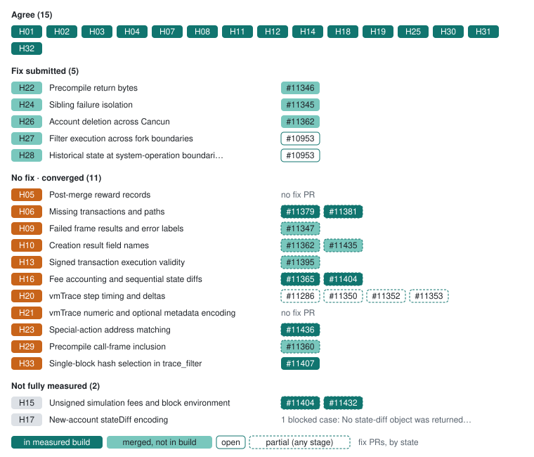

# Besu: changes to review

Start with failed-frame reporting, precompile output and inclusion, and range-filter consistency. Individual replay also needs a scope decision. 26.10.0 · 976ca7ea and 26.10.1 · e83703cd, which only unschedules Amsterdam on Hoodi, ship what the October 11 development build carried: it runs unsigned calls like eth_call (#11404), returns rejected trace_callMany bundles as one JSON-RPC error (#11401), starts each trace_callMany call at a transaction boundary (#11365), reports each rejected item with its own reason (#11432) and selects exactly the hashed block in trace_filter (#11407). It and the development build also return null for an unknown transaction hash (#11379) and Block not found for an unknown block (#11381). 26.10.2 · d3e1aea7 added the trace_filter mode member (#11436, H03) and the omitted trace_callMany block (#11440, H31); 26.11.0 · 0e595f9e shipped the same trace changes and agreed on 8 decisions. 26.11.2 · 09b9e94d adds trace_replayTransaction (#11406, H01), so the replay cases of H07, H08, H18 and H19 run and agree, rejects malformed trace_filter members and legacy calls for another chain (#11439), resolves safe and finalized trace_filter bounds while rejecting pending (#11441, H32), keeps failures local to their frame (#11345, H24), retains precompile output (#11346, H22) and nonzero-value precompile frames (#11360), reports empty code for self-destructing creations (#11362, H26) and creationMethod on every create frame (#11435, H10). It agrees on 19 decisions. It ignores trailing trace_call parameters, so positional state and block overrides run on unmodified state (H15) and an account override with both state and stateDiff is accepted (H14). 26.11-develop · f58f40e2 rejects those parameters and also retains root precompile halt reasons (#11347): it agrees on 20 decisions.

[All clients](../README.md) · [Client fixes](../../docs/client-fixes.md) · [Source guide](../sources.md)

**Progress on 26.11-develop · f58f40e2** (of 33 decisions): ✅ 20 agree (+5 since the previous capture) · 🛠️ 2 fix submitted · ⚠️ 9 with no fix yet (9 on converged decisions) · ⚪ 2 not fully measured. 1 of these agreements are not yet in 26.11.2 · 09b9e94d. Upstream fix PRs: 19 merged, 5 open ([client fixes](../../docs/client-fixes.md)).

Each decision on the development build, grouped as in the [progress chart](../README.md#progress), with the client’s fix PRs ([client fixes](../../docs/client-fixes.md)), styled by stage as its legend shows: in the measured development build, merged but not in that build yet, or open, with a dashed edge when a PR covers only part of the decision.

| Tested version | Commit | Commit date (UTC) | Tested (UTC) |
| --- | --- | --- | --- |
| `26.11.2` | [`09b9e94d`](https://github.com/besu-eth/besu/commit/09b9e94dd585f2dc7174adcdeeac96590c0becd0) | 2026-11-23 | [2026-11-25](../../evidence/2026-11-25/eval/initial/manifest.json) |
| `26.11-develop` | [`f58f40e2`](https://github.com/besu-eth/besu/commit/f58f40e2095db8295b780f75e01aa2108716e5d9) | 2026-11-25 | [2026-11-25](../../evidence/2026-11-25/eval/initial/manifest.json) |

Code links use the tested development sources (or the Geth fork). These are proposed changes for the tested builds. “Checked cases agree” refers to the linked examples, not every behavior of a method. [Test status key](../technical.md#test-status-key).

## Changes to discuss

| Behavior | 26.11.2 · 09b9e94d | 26.11-develop · f58f40e2 | Proposed change |
| --- | --- | --- | --- |
| [Post-merge reward records](../decisions/H05.md) PoS blocks include a synthetic PoW reward record. | ⚠️ Differs [_reference/block/0x30](../cases/a/_reference/block/0x30.md) | ⚠️ Differs [_reference/block/0x30](../cases/a/_reference/block/0x30.md) | Remove the placeholder reward. This also changes which records pagination counts. Checked requirements: A PoS block has no synthetic PoW reward records. [Filter execution pipeline](https://github.com/besu-eth/besu/blob/f9572aa82a2dadb3dd1b218d3ca97101540faf97/ethereum/api/src/main/java/org/hyperledger/besu/ethereum/api/jsonrpc/internal/methods/TraceFilter.java#L135) · [Call-frame inclusion](https://github.com/besu-eth/besu/blob/f9572aa82a2dadb3dd1b218d3ca97101540faf97/ethereum/api/src/main/java/org/hyperledger/besu/ethereum/api/jsonrpc/internal/results/tracing/flat/FlatTraceGenerator.java#L284) |
| [Missing transactions and paths](../decisions/H06.md) Unknown transactions can return [] and an unknown selected block returns null. | ⚠️ Differs [Missing block block](../cases/a/missing-block-block.md) | ⚠️ Differs [Missing block block](../cases/a/missing-block-block.md) | Return `null` for an unknown transaction, so callers can distinguish absence from a transaction with no call records. Filter bounds beyond the head already return `-32602` as proposed. Checked requirements: An unknown selected block returns an error with code -32001, never null or a result. [Trace lookup](https://github.com/besu-eth/besu/blob/f9572aa82a2dadb3dd1b218d3ca97101540faf97/ethereum/api/src/main/java/org/hyperledger/besu/ethereum/api/jsonrpc/internal/methods/TraceGet.java#L37) · [Block replay](https://github.com/besu-eth/besu/blob/f9572aa82a2dadb3dd1b218d3ca97101540faf97/ethereum/api/src/main/java/org/hyperledger/besu/ethereum/api/jsonrpc/internal/methods/TraceReplayBlockTransactions.java#L58) |
| [Failed frame results and error labels](../decisions/H09.md) Failed frames lose result information; a failed root precompile can also lack an error. | ⚠️ Differs · [Besu #11347](https://github.com/besu-eth/besu/pull/11347) (partial fix) 1 blocked case: Address selection differs from its reference; failure-bearing frame selection is not established. 1 blocked case: No failed attempts ['call', 'create'] under the deepest executed frame at depth 1025. 1 blocked case: No frame matches {'action': {'value': '0x1'}, 'traceAddress': [0], 'type': 'call'}. 1 blocked case: No frame matches {'action': {'value': '0x1'}, 'traceAddress': [0], 'type': 'create'}. [Auth replace](../cases/a/auth-replace.md) | ⚠️ Differs 1 blocked case: Address selection differs from its reference; failure-bearing frame selection is not established. 1 blocked case: No failed attempts ['call', 'create'] under the deepest executed frame at depth 1025. 1 blocked case: No frame matches {'action': {'value': '0x1'}, 'traceAddress': [0], 'type': 'call'}. 1 blocked case: No frame matches {'action': {'value': '0x1'}, 'traceAddress': [0], 'type': 'create'}. [Auth replace](../cases/a/auth-replace.md) | Keep the error on the failing frame, including a failed root precompile. Add `result: {gasUsed, output}` to REVERT frames; exceptional halts may keep omitting `result`. Use the listed labels, e.g. "Mutable Call In Static Context" and "Built-in failed". `revertReason` is outside the format and may stay as an extension once `result` is present. Checked requirements: A REVERT frame keeps result {gasUsed, output}; a reverted CREATE has no address or code. The fixture REVERT frame preserves its exact return bytes and opcode gas, regardless of error wording. Failed frames have an error string; an exceptional halt carries result null. A failed root precompile reports its own execution error. The modelled REVERT root retains its exact return bytes and independently calculated execution gas. A CREATE2 address collision frame has error "Contract address collision". A reverted nested CREATE has error "Reverted" and result {gasUsed, output} with its revert bytes and execution gas, without address or code. Code above the EIP-170 size limit fails the creation with "Out of gas", as Parity and EIP-170 report it. Code beginning with 0xEF (EIP-3541) fails the creation with "Invalid code", as OpenEthereum reports it. A reverted CREATE reports error Reverted and result {gasUsed, output} with its revert bytes and no address or code; root action.gas excludes intrinsic gas. Replay output carries the revert bytes. A reverted nested CREATE reports error Reverted and result {gasUsed, output} without address or code. [Call-frame inclusion](https://github.com/besu-eth/besu/blob/f9572aa82a2dadb3dd1b218d3ca97101540faf97/ethereum/api/src/main/java/org/hyperledger/besu/ethereum/api/jsonrpc/internal/results/tracing/flat/FlatTraceGenerator.java#L284) |
| [Invalid parameters and rejected calls](../decisions/H14.md) Wrong address-list types and negative count can return results rather than invalid params. | ⚠️ Differs [Override state exclusive](../cases/probes-prague/override-state-exclusive.md) | ✅ Checked cases agree [Call null mode](../cases/a/call-null-mode.md) | Validate filter types and bounds and reject invalid request shapes (-32602 recommended). Checked requirements: Malformed input returns an error (-32602 recommended). An account override with both state and stateDiff is rejected (-32602 recommended). [Signed transaction replay](https://github.com/besu-eth/besu/blob/f9572aa82a2dadb3dd1b218d3ca97101540faf97/ethereum/api/src/main/java/org/hyperledger/besu/ethereum/api/jsonrpc/internal/methods/TraceRawTransaction.java#L46) · [Call simulation](https://github.com/besu-eth/besu/blob/f9572aa82a2dadb3dd1b218d3ca97101540faf97/ethereum/api/src/main/java/org/hyperledger/besu/ethereum/api/jsonrpc/internal/methods/AbstractTraceCall.java#L40) |
| [Unsigned simulation fees and block environment](../decisions/H15.md) 26.9.0 · ee9c64c8: paired eth_call executes explicit zero fees with BASEFEE 0, while trace_call returns an internal error; an omitted fee is priced and charged at the base fee in trace_call but free in eth_call, and invalid trace fee/funding requests produce generic internal errors. 26.10-develop · 711f8142 includes #11404: trace_call and every trace_callMany item run an unpriced call like eth_call (GASPRICE and BASEFEE 0, no fee effects) and validate and charge a priced one. Its trace_call names each rejection with Besu’s own codes (-32009 below the base fee, -32004 insufficient funds, -32003 intrinsic gas) instead of the eth_simulateV1 codes, and reports a positive tip over a zero or omitted fee cap as below the base fee instead of as a priority fee above the cap. trace_callMany answers every rejected item, whatever the violation, with -32603 Internal error, so 152 rejection checks are unassessable. Both builds reject a supplied nonce below the state nonce, 26.9.0 with -32603 and the development build with -32001 (“Nonce too low”). On blob calls an omitted or zero `maxFeePerBlobGas` runs at the head’s BLOBBASEFEE (1) instead of 0; the development build accepts the explicit zero, which 26.9.0 rejects with an internal error. 26.10-develop · d05d8e74 includes #11432 and no H15 difference remains: each rejected trace_callMany item reports its own reason, a tip above the cap is reported first, a supplied nonce is ignored and an omitted or zero `maxFeePerBlobGas` runs at BLOBBASEFEE 0. Two trace_callMany gas witnesses stay blocked. 26.11.2 · 09b9e94d ignores trace_call’s fourth and fifth parameters, so positional state and block overrides run on unmodified state; 26.11-develop · f58f40e2 rejects them (-32602), which the draft allows. | ⚠️ Differs 2 blocked cases: No receipt gas or execution-gas witness was captured. [Override block number](../cases/probes-prague/override-block-number.md) | 🟡 Partially assessed 2 blocked cases: No receipt gas or execution-gas witness was captured. [Many storage write revert read](../cases/a/many-storage-write-revert-read.md) | Ship #11404 and #11432 in a release. [Call simulation](https://github.com/besu-eth/besu/blob/f9572aa82a2dadb3dd1b218d3ca97101540faf97/ethereum/api/src/main/java/org/hyperledger/besu/ethereum/api/jsonrpc/internal/methods/AbstractTraceCall.java#L40) |
| [Fee accounting and sequential state diffs](../decisions/H16.md) 26.9.0: `trace_callMany` does not start each call at a transaction boundary, so a later call’s SSTORE uses the pre-bundle original value of a slot an earlier call wrote; `probes-prague/many-original-value` measures a 2,208-gas SSTORE where 5,008 is expected. 26.10-develop · d05d8e74 includes #11365 and #11432: every call starts at a boundary and a rejected item returns its own funds rejection. Both builds still differ on the `mined-probes` block 2 replay’s fee accounting and on the declared state-diff fixture of `initial/raw-valid-default-block`. | ⚠️ Differs [Replay beacon root read](../cases/mined-probes/replay-beacon-root-read.md) | ⚠️ Differs [Replay beacon root read](../cases/mined-probes/replay-beacon-root-read.md) | Ship #11365 in a release. Pay the exact miner tip and burn the block base fee in the block 2 replay’s balance deltas. Checked requirements: Account balance deltas conserve transferred value, pay the exact miner tip and burn the selected block base fee, blob fee and any wei a same-transaction SELFDESTRUCT destroys. [Call simulation](https://github.com/besu-eth/besu/blob/f9572aa82a2dadb3dd1b218d3ca97101540faf97/ethereum/api/src/main/java/org/hyperledger/besu/ethereum/api/jsonrpc/internal/methods/AbstractTraceCall.java#L40) · [State differences](https://github.com/besu-eth/besu/blob/f9572aa82a2dadb3dd1b218d3ca97101540faf97/ethereum/api/src/main/java/org/hyperledger/besu/ethereum/api/jsonrpc/internal/results/tracing/diff/StateTraceGenerator.java#L148) |
| [vmTrace step timing and deltas](../decisions/H20.md) The `MCOPY` step omits its memory write, and CALL-family `mem` can copy the calling frame’s final RETURN. A value CALL’s `cost` includes the stipend and a precompile CALL’s the precompile cost; a CALL or CREATE that fails its precheck reports its net cost and a `sub`; a halted operation keeps a bogus `ex`. | ⚠️ Differs · [Besu #11286](https://github.com/besu-eth/besu/pull/11286) (partial fix) · [Besu #11350](https://github.com/besu-eth/besu/pull/11350) (partial fix) · [Besu #11352](https://github.com/besu-eth/besu/pull/11352) (partial fix) · [Besu #11353](https://github.com/besu-eth/besu/pull/11353) (partial fix) [Call mcopy](../cases/a/call-mcopy.md) | ⚠️ Differs · [Besu #11286](https://github.com/besu-eth/besu/pull/11286) (partial fix) · [Besu #11350](https://github.com/besu-eth/besu/pull/11350) (partial fix) · [Besu #11352](https://github.com/besu-eth/besu/pull/11352) (partial fix) · [Besu #11353](https://github.com/besu-eth/besu/pull/11353) (partial fix) [Call mcopy](../cases/a/call-mcopy.md) | Include the bytes written at offset 32 in the MCOPY step’s memory delta, and stop copying the caller’s final RETURN into CALL-family `mem` (the copied bytes then conform). Exclude the stipend from value-CALL `cost`, include forwarded gas in precompile-call and failed-precheck `cost`, give a failed-precheck operation `sub: null`, and report a halted operation with `ex: null`. Checked requirements: At every VM depth, every pc lies inside the code, PUSH matches bytecode, each step deducts its cost and a call or creation also receives its child leftover or, entering no frame, includes the gas it forwarded, subtraces appear only on calls and creations, MLOAD mem is its loaded word, call mem is the output window or the copied return data, and RETURN/REVERT report no mem. MCOPY reports its same-step write of word 42 at offset 32. The independently executable replay/raw root has exact costs, post-step gas, stack and memory effects. Every modelled step has exact opcode cost, post-step gas, stack effects, memory writes and storage effects. The CALL whose precheck failed has sub null; the sibling that entered a frame has a sub. The CREATE whose precheck failed has sub null; the sibling that entered a frame has a sub. [VM memory deltas](https://github.com/besu-eth/besu/blob/f9572aa82a2dadb3dd1b218d3ca97101540faf97/ethereum/api/src/main/java/org/hyperledger/besu/ethereum/api/jsonrpc/internal/results/tracing/vm/VmTraceGenerator.java#L230) |
| [vmTrace numeric and optional metadata encoding](../decisions/H21.md) The linked case differs from the proposed behavior. | ⚠️ Differs [Auth replace](../cases/a/auth-replace.md) | ⚠️ Differs [Auth replace](../cases/a/auth-replace.md) | Every operation names its op and has only the specified members; stack words and storage operands use minimal hex quantities at every depth. [VM memory deltas](https://github.com/besu-eth/besu/blob/f9572aa82a2dadb3dd1b218d3ca97101540faf97/ethereum/api/src/main/java/org/hyperledger/besu/ethereum/api/jsonrpc/internal/results/tracing/vm/VmTraceGenerator.java#L230) |
| [Special-action address matching](../decisions/H23.md) CREATE and SELFDESTRUCT address queries disagree with the corresponding block trace. | ⚠️ Differs [Filter created to](../cases/a/filter-created-to.md) | ⚠️ Differs [Filter created to](../cases/a/filter-created-to.md) | Match creation by creator/created address, SELFDESTRUCT by executing account/beneficiary, and rewards by `author` on the recipient side. Checked requirements: A CREATE, SELFDESTRUCT or reward record matches the lists by its own from/to equivalents. Compare address bytes: OR within each list, AND across lists by default and OR under mode union; missing/null/empty lists are unrestricted. A created-then-destroyed address matches its creation and its SELFDESTRUCT beneficiary. A SELFDESTRUCT matches fromAddress by its executing account. A SELFDESTRUCT to self also matches toAddress as its own beneficiary. [Filter execution pipeline](https://github.com/besu-eth/besu/blob/f9572aa82a2dadb3dd1b218d3ca97101540faf97/ethereum/api/src/main/java/org/hyperledger/besu/ethereum/api/jsonrpc/internal/methods/TraceFilter.java#L135) |
| [Filter execution across fork boundaries](../decisions/H27.md) A range filter differs from concatenating the same blocks’ traces across a fork boundary. | 🛠️ Fix submitted: [Besu #10953](https://github.com/besu-eth/besu/pull/10953) [Filter across 36](../cases/forks/filter-across-36.md) | 🛠️ Fix submitted: [Besu #10953](https://github.com/besu-eth/besu/pull/10953) [Filter across 36](../cases/forks/filter-across-36.md) | Trace each block from its parent’s post-block state with its own pre-block system calls, under its own fork rules, so range filtering agrees with per-block tracing. Swapping the protocol spec alone leaves rewards, withdrawals and system calls between blocks unapplied. Checked requirements: A fork-crossing range equals the corresponding per-block traces. [Filter execution pipeline](https://github.com/besu-eth/besu/blob/f9572aa82a2dadb3dd1b218d3ca97101540faf97/ethereum/api/src/main/java/org/hyperledger/besu/ethereum/api/jsonrpc/internal/methods/TraceFilter.java#L135) |
| [Historical state at system-operation boundaries](../decisions/H28.md) From source: block replay does not run the block’s pre-block system calls, so a transaction that reads the EIP-4788 or EIP-2935 contracts sees stale storage. The captured H28 probes use trace_call only. | 🛠️ Fix submitted: [Besu #10953](https://github.com/besu-eth/besu/pull/10953) [Block 2](../cases/mined-probes/block-2.md) | 🛠️ Fix submitted: [Besu #10953](https://github.com/besu-eth/besu/pull/10953) [Block 2](../cases/mined-probes/block-2.md) | Apply the block’s pre-execution system calls before replaying its transactions ([Besu #10953](https://github.com/besu-eth/besu/pull/10953)). Checked requirements: Replay applies the block’s pre-transaction system call, so the read returns the value the block stored. Replay applies the block’s pre-transaction system call, so the read returns the value the block stored. The reader records STATICCALL success and the word in slots 1 and 0. The vmTrace SSTOREs write the observed success flag and word. [Call simulation](https://github.com/besu-eth/besu/blob/f9572aa82a2dadb3dd1b218d3ca97101540faf97/ethereum/api/src/main/java/org/hyperledger/besu/ethereum/api/jsonrpc/internal/methods/AbstractTraceCall.java#L40) |
| [Precompile call-frame inclusion](../decisions/H29.md) Nested precompile frames are omitted even when their value is nonzero. A CALL that fails its balance precheck has no frame, and a CREATE that fails it leaves a successful-looking frame at `[0]`, moves the real creation below it and reports the root as using no gas. | ⚠️ Differs [Depth limit](../cases/probes-forks/depth-limit.md) | ⚠️ Differs [Depth limit](../cases/probes-forks/depth-limit.md) | Retain nested precompile frames with transferred or inherited nonzero value (#11360). Continue omitting zero-value nested frames and retaining root frames. Give a CALL or CREATE that fails its balance or depth precheck a failed frame with error "Insufficient balance for transfer", no result and no children, as Besu's callTracer already records it; no submitted fix covers this. Checked requirements: A CALL or CREATE that fails its balance precheck emits a failed frame with no result and no subtraces; the next sibling follows at [1] and the parent counts both. Under the deepest executed frame, at depth 1024, the CALL and CREATE that fail the depth precheck each emit a failed frame with no result and no subtraces. Under the deepest executed frame, at depth 1024, the CALL that fails the depth precheck emits a failed frame, and the zero-value call to a precompile that fails the same check emits none. [Call-frame inclusion](https://github.com/besu-eth/besu/blob/f9572aa82a2dadb3dd1b218d3ca97101540faf97/ethereum/api/src/main/java/org/hyperledger/besu/ethereum/api/jsonrpc/internal/results/tracing/flat/FlatTraceGenerator.java#L284) |
| [Single-block hash selection in trace_filter](../decisions/H33.md) 26.9.0 parses `blockHash` but never reads it, so `{blockHash: H2}` traces the head (block 0x30) with or without address lists, a page, null bounds or the genesis hash, and returns `[]` where the head has no matching records. An unknown hash also answers with the head, and `[]` with `count: 0`; `{blockHash, fromBlock: 0x2}` answers block 2. A short hash and an EIP-1898 object are rejected with -32602. In the reorg scenario every A and B hash answers with the current head, including A’s after the switch. The mode union case is blocked: Besu rejects mode union without the member too. 26.10-develop · d05d8e74 includes #11407: it selects exactly the hashed block, rejects an unknown hash and a hash with bounds, and agrees in the reorg scenario; only the mode union case stays blocked. | ⚠️ Differs [Filter blockhash unknown](../cases/h30/filter-blockhash-unknown.md) | ⚠️ Differs [Filter blockhash unknown](../cases/h30/filter-blockhash-unknown.md) | Ship #11407 in a release. [Filter execution pipeline](https://github.com/besu-eth/besu/blob/f9572aa82a2dadb3dd1b218d3ca97101540faf97/ethereum/api/src/main/java/org/hyperledger/besu/ethereum/api/jsonrpc/internal/methods/TraceFilter.java#L135) |

## Open policy observations

These results record behavior whose policy is unresolved. Passing a checked part of a topic does not settle the remaining choices.

| Build | Decision | Observed | Example |
| --- | --- | --- | --- |
| 26.11.2 · 09b9e94d | [Raw-transaction block argument](../decisions/H12.md) | 6 extension cases. Selector block 0x0 by number: rejected as invalid params (-32602: Invalid number of params). Selector latest: rejected as invalid params (-32602: Invalid number of params). Selector block 0x19 by number: rejected as invalid params (-32602: Invalid number of params). Selector block 0x19 by hash: rejected as invalid params (-32602: Invalid number of params). Selector block 0x19 as an EIP-1898 object: rejected as invalid params (-32602: Invalid number of params). Selector pending: rejected as invalid params (-32602: Invalid number of params). | [Raw valid](../cases/initial/raw-valid.md) · [Raw state hash](../cases/raw-selector/raw-state-hash.md) |
| 26.11-develop · f58f40e2 | [Raw-transaction block argument](../decisions/H12.md) | 6 extension cases. Selector block 0x0 by number: rejected as invalid params (-32602: Invalid number of params). Selector latest: rejected as invalid params (-32602: Invalid number of params). Selector block 0x19 by number: rejected as invalid params (-32602: Invalid number of params). Selector block 0x19 by hash: rejected as invalid params (-32602: Invalid number of params). Selector block 0x19 as an EIP-1898 object: rejected as invalid params (-32602: Invalid number of params). Selector pending: rejected as invalid params (-32602: Invalid number of params). | [Raw valid](../cases/initial/raw-valid.md) · [Raw state hash](../cases/raw-selector/raw-state-hash.md) |

Result-shape differences are recorded on the [case pages](../technical.md#result-shape-checks); schema validity is separate from semantic coverage.

## Assessment gaps

| Decision | Build | Reason | Example |
| --- | --- | --- | --- |
| [Signed transaction execution validity](../decisions/H13.md) | 26.11.2 · 09b9e94d | 4 blocked cases: The error does not identify a validation failure: -32007 Sender account not authorized to send transactions (Sender 0x2b5ad5c4795c026514f8317c7a215e218dccd6cf has deployed code . | [Raw validation code sender all](../cases/raw-validation/raw-validation-code-sender-all.md) · [Raw validation code sender statediff](../cases/raw-validation/raw-validation-code-sender-stateDiff.md) |
| [Signed transaction execution validity](../decisions/H13.md) | 26.11-develop · f58f40e2 | 4 blocked cases: The error does not identify a validation failure: -32007 Sender account not authorized to send transactions (Sender 0x2b5ad5c4795c026514f8317c7a215e218dccd6cf has deployed code . | [Raw validation code sender all](../cases/raw-validation/raw-validation-code-sender-all.md) · [Raw validation code sender statediff](../cases/raw-validation/raw-validation-code-sender-stateDiff.md) |
| [Unsigned simulation fees and block environment](../decisions/H15.md) | 26.11-develop · f58f40e2 | 2 blocked cases: No receipt gas or execution-gas witness was captured. | [Many storage write revert read](../cases/a/many-storage-write-revert-read.md) · [Write revert read/many storage write revert read](../cases/callmany-isolation/write-revert-read/many-storage-write-revert-read.md) |

✅ Behaviors with no difference in the checked cases

| Behavior | Examples |
| --- | --- |
| [trace_get selector and return shape](../decisions/H02.md) | [_reference/block/0x30](../cases/a/_reference/block/0x30.md) · [Block 2](../cases/a/block-2.md) |
| [Filter composition and mode](../decisions/H03.md) | [Filter all](../cases/a/filter-all.md) · [Filter both unknown mode](../cases/a/filter-both-unknown-mode.md) |
| [Empty address lists](../decisions/H04.md) | [Filter both null](../cases/a/filter-both-null.md) · [Filter from empty to set](../cases/a/filter-from-empty-to-set.md) |
| [Replay transactionHash field](../decisions/H07.md) | [Replay 35](../cases/forks/replay-35.md) · [Replay 36](../cases/forks/replay-36.md) |
| [Empty output and unrequested components](../decisions/H08.md) | [Auth clear](../cases/a/auth-clear.md) · [Auth replace](../cases/a/auth-replace.md) |
| [Creation result field names](../decisions/H10.md) | [Call mixed create](../cases/a/call-mixed-create.md) · [Model empty runtime](../cases/coverage/model-empty-runtime.md) |
| [Empty trace-type selection](../decisions/H11.md) | [Empty types](../cases/a/empty-types.md) · [Call empty types](../cases/initial/call-empty-types.md) |
| [Raw-transaction block argument](../decisions/H12.md) | [Raw valid current nonce](../cases/initial/raw-valid-current-nonce.md) · [Raw state default](../cases/raw-selector/raw-state-default.md) |
| [Invalid parameters and rejected calls](../decisions/H14.md) (26.11-develop · f58f40e2) | [Call null mode](../cases/a/call-null-mode.md) · [Call scalar mode](../cases/a/call-scalar-mode.md) |
| [New-account stateDiff encoding](../decisions/H17.md) | [Prefunded empty](../cases/a/prefunded-empty.md) · [Model empty runtime](../cases/coverage/model-empty-runtime.md) |
| [EIP-7702 code changes in stateDiff](../decisions/H18.md) | [Auth clear](../cases/a/auth-clear.md) · [Auth replace](../cases/a/auth-replace.md) |
| [vmTrace executing bytecode](../decisions/H19.md) | [Auth clear](../cases/a/auth-clear.md) · [Auth replace](../cases/a/auth-replace.md) |
| [Precompile return bytes](../decisions/H22.md) | [Call identity](../cases/initial/call-identity.md) |
| [Sibling failure isolation](../decisions/H24.md) | [Call siblings revert ok](../cases/a/call-siblings-revert-ok.md) · [Nested call outer0 value1 failed](../cases/precompile-values/nested-call-outer0-value1-failed.md) |
| [Well-formed errors for rejected raw transactions](../decisions/H25.md) | [Auth clear](../cases/a/auth-clear.md) · [Auth replace](../cases/a/auth-replace.md) |
| [Account deletion across Cancun](../decisions/H26.md) | [Destroy trace 55](../cases/fork-followup/destroy-trace-55.md) · [Destroy trace 56](../cases/fork-followup/destroy-trace-56.md) |
| [Omitted trace_filter range bounds](../decisions/H30.md) | [Filter no bounds](../cases/h30/filter-no-bounds.md) · [Filter to 2 implicit from](../cases/h30/filter-to-2-implicit-from.md) |
| [Omitted trace_callMany block](../decisions/H31.md) | [Call number default](../cases/h30/call-number-default.md) · [Call number latest](../cases/h30/call-number-latest.md) |
| [Trace block tags and pending state](../decisions/H32.md) | [Call number pending](../cases/h30/call-number-pending.md) · [Filter earliest](../cases/h30/filter-earliest.md) |

[Method availability](../decisions/H01.md) · [All decisions](../../decisions/README.md)

For setup gaps, exact run inventories and reproduction, see the [technical appendix](../technical.md).
