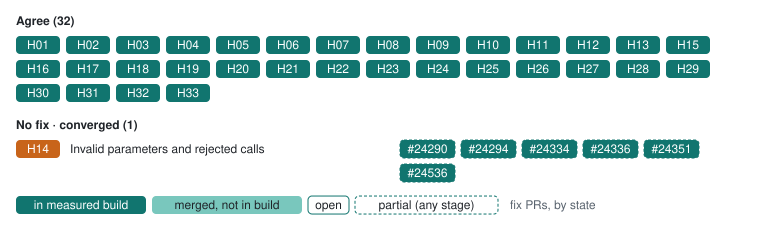

# Erigon: changes to review

The development build agrees on tree lookup, default filter composition, MCOPY, historical system state including trace_callMany, the genesis reward, omitted trace_filter bounds (#24341), reverted-CREATE results and failure labels (#24355, #24356) and failed-CREATE filter matching, several of which still differ in 3.7.0. Since #24330 and #24343 its trace_call prices gas like eth_call, keeps the block GASLIMIT and returns the eth_simulateV1 codes. It validates signed transactions at the selected state (#24329) rejecting each for its own violation (with -32000; the error-group codes are recommended); a filter bound past the head still returns [] (#24357 is open) and vmTrace still keeps halted-operation details (#24344 is open). Since #24032, 3.8.0-dev · 5b452f41 keeps safe and finalized hashes from a same-head forkchoice update, so the reorg scenario runs and H33 agrees, and #24706 rejects an unknown trace_filter member. Its one remaining difference was a call with maxFeePerBlobGas and no blob hashes, which ran with the cap ignored (H14). #24990 rejects it. When the draft then pinned forms it had left open for exact fixtures (5e6717fe), #25030 followed: reward records with null transaction fields (H05), -32001 for an unknown trace_call block (H06) and no vmTrace idx (H21). 3.9.0-dev · 6955d198 agrees on all 33 decisions. The 3.8.1 · cf6f1413 release, like 3.8.0, ships all the earlier fixes and agrees on 29: it lacks #24990 and #25030.

[All clients](../README.md) · [Client fixes](../../docs/client-fixes.md) · [Source guide](../sources.md)

**Progress on 3.9.0-dev · 6955d198** (of 33 decisions): ✅ 33 agree. 4 of these agreements are not yet in 3.8.1 · cf6f1413. Upstream fix PRs: 26 merged, 0 open ([client fixes](../../docs/client-fixes.md)).

Each decision on the development build, grouped as in the [progress chart](../README.md#progress), with the client’s fix PRs ([client fixes](../../docs/client-fixes.md)), styled by stage as its legend shows: in the measured development build, merged but not in that build yet, or open, with a dashed edge when a PR covers only part of the decision.

| Tested version | Commit | Commit date (UTC) | Tested (UTC) |
| --- | --- | --- | --- |
| `3.8.1` | [`cf6f1413`](https://github.com/erigontech/erigon/commit/cf6f14132ff042df33b8ce64b0114daeb0d15145) | 2026-10-23 | [2026-10-29](../../evidence/2026-10-29/eval/initial/manifest.json) |
| `3.9.0-dev` | [`6955d198`](https://github.com/erigontech/erigon/commit/6955d1985e90b0dc1646e1ea68beb9aae1d3b2c4) | 2026-10-29 | [2026-10-29](../../evidence/2026-10-29/eval/initial/manifest.json) |

Code links use the tested development sources (or the Geth fork). These are proposed changes for the tested builds. “Checked cases agree” refers to the linked examples, not every behavior of a method. [Test status key](../technical.md#test-status-key).

## Changes to discuss

| Behavior | 3.8.1 · cf6f1413 | 3.9.0-dev · 6955d198 | Proposed change |
| --- | --- | --- | --- |
| [Post-merge reward records](../decisions/H05.md) Main 1ee57924 omits transactionHash and transactionPosition from reward records instead of setting them to null, which the pinned draft requires. | 🛠️ Fix submitted: [Erigon #25030](https://github.com/erigontech/erigon/pull/25030) [Block 35](../cases/forks/block-35.md) | ✅ Checked cases agree [_reference/block/0x30](../cases/a/_reference/block/0x30.md) | Emit transactionHash and transactionPosition as null on reward records. Checked requirements: Reward records carry null transactionHash and transactionPosition. [Address filtering](https://github.com/erigontech/erigon/blob/e26d9bd4056586e004488c31b561fb2663d46019/rpc/jsonrpc/trace_filtering.go#L311) · [Call frames and precompiles](https://github.com/erigontech/erigon/blob/e26d9bd4056586e004488c31b561fb2663d46019/rpc/jsonrpc/trace_adhoc.go#L378) |
| [Missing transactions and paths](../decisions/H06.md) A missing transaction, path or replay returns null as proposed. An unknown selected block, including a block replay, returned -32000 in earlier builds, and a filter bound beyond the head returns [] (an explicit "waiting for spec" choice). 3.8.0-dev · a1ce80fb includes #24341 and returns -32602 for a reversed range. Main 1ee57924 answers an unknown trace_call block with -32000; the pinned draft requires -32001 in every method. | 🛠️ Fix submitted: [Erigon #25030](https://github.com/erigontech/erigon/pull/25030) [Missing block call](../cases/a/missing-block-call.md) | ✅ Checked cases agree [Missing block block](../cases/a/missing-block-block.md) | Return -32001 for an unknown trace_call or trace_callMany block. Checked requirements: An unknown selected block returns an error with code -32001, never null or a result. [Trace lookup](https://github.com/erigontech/erigon/blob/e26d9bd4056586e004488c31b561fb2663d46019/rpc/jsonrpc/trace_filtering.go#L135) · [Replay results](https://github.com/erigontech/erigon/blob/e26d9bd4056586e004488c31b561fb2663d46019/rpc/jsonrpc/trace_adhoc.go#L920) |
| [Invalid parameters and rejected calls](../decisions/H14.md) Malformed raw transactions and an unknown option use error codes other than `-32602`, and an unknown filter field is accepted. 3.7.0 drops `input` and every post-Berlin call field, so an `input`-only call runs with empty calldata. 3.8.0-dev · a2a19253 includes #24290, #24294, #24334, #24351 and #24336: it decodes `input` and the post-Berlin fields, treats an explicit null as omitted, rejects a chainId for another chain and rejects disagreeing `data` and `input` with -32602. | 🛠️ Fix submitted: [Erigon #24990](https://github.com/erigontech/erigon/pull/24990) [Fork blob fee only at](../cases/probes-forks/fork-blob-fee-only-at.md) | ✅ Checked cases agree [Call null mode](../cases/a/call-null-mode.md) | Reject malformed input, unknown filter fields and unknown trace types (`-32602` recommended), separately from execution rejection. Ship the call-field fixes in a release. Checked requirements: A maxFeePerBlobGas without blobVersionedHashes at block 55, before Cancun (block 56) describes no transaction, so the call is rejected (-32003 recommended), never run with the field ignored. A maxFeePerBlobGas without blobVersionedHashes at block 56, at Cancun (block 56) describes no transaction, so the call is rejected (-32003 recommended), never run with the field ignored. [Signed transaction replay](https://github.com/erigontech/erigon/blob/e26d9bd4056586e004488c31b561fb2663d46019/rpc/jsonrpc/trace_adhoc.go#L1695) · [Call simulation](https://github.com/erigontech/erigon/blob/e26d9bd4056586e004488c31b561fb2663d46019/rpc/jsonrpc/trace_adhoc.go#L1096) |
| [vmTrace numeric and optional metadata encoding](../decisions/H21.md) Main 1ee57924 adds idx to each vmTrace operation; the pinned draft allows only pc, cost, op, ex and sub. | 🛠️ Fix submitted: [Erigon #25030](https://github.com/erigontech/erigon/pull/25030) [Auth replace](../cases/a/auth-replace.md) | ✅ Checked cases agree [Auth clear](../cases/a/auth-clear.md) | Drop idx from vmTrace operations. Checked requirements: Every operation names its op and has only the specified members; stack words and storage operands use minimal hex quantities at every depth. [VM execution deltas](https://github.com/erigontech/erigon/blob/e26d9bd4056586e004488c31b561fb2663d46019/rpc/jsonrpc/trace_adhoc.go#L577) |

## Open policy observations

These results record behavior whose policy is unresolved. Passing a checked part of a topic does not settle the remaining choices.

| Build | Decision | Observed | Example |
| --- | --- | --- | --- |
| 3.8.1 · cf6f1413 | [Raw-transaction block argument](../decisions/H12.md) | 6 extension cases. Selector block 0x0 by number: rejected as invalid params (-32602: too many arguments, want at most 2). Selector latest: rejected as invalid params (-32602: too many arguments, want at most 2). Selector block 0x19 by number: rejected as invalid params (-32602: too many arguments, want at most 2). Selector block 0x19 by hash: rejected as invalid params (-32602: too many arguments, want at most 2). Selector block 0x19 as an EIP-1898 object: rejected as invalid params (-32602: too many arguments, want at most 2). Selector pending: rejected as invalid params (-32602: too many arguments, want at most 2). | [Raw valid](../cases/initial/raw-valid.md) · [Raw state hash](../cases/raw-selector/raw-state-hash.md) |
| 3.9.0-dev · 6955d198 | [Raw-transaction block argument](../decisions/H12.md) | 6 extension cases. Selector block 0x0 by number: rejected as invalid params (-32602: too many arguments, want at most 2). Selector latest: rejected as invalid params (-32602: too many arguments, want at most 2). Selector block 0x19 by number: rejected as invalid params (-32602: too many arguments, want at most 2). Selector block 0x19 by hash: rejected as invalid params (-32602: too many arguments, want at most 2). Selector block 0x19 as an EIP-1898 object: rejected as invalid params (-32602: too many arguments, want at most 2). Selector pending: rejected as invalid params (-32602: too many arguments, want at most 2). | [Raw valid](../cases/initial/raw-valid.md) · [Raw state hash](../cases/raw-selector/raw-state-hash.md) |

Result-shape differences are recorded on the [case pages](../technical.md#result-shape-checks); schema validity is separate from semantic coverage.

✅ Behaviors with no difference in the checked cases

| Behavior | Examples |
| --- | --- |
| [trace_get selector and return shape](../decisions/H02.md) | [_reference/block/0x30](../cases/a/_reference/block/0x30.md) · [Block 2](../cases/a/block-2.md) |
| [Filter composition and mode](../decisions/H03.md) | [Filter all](../cases/a/filter-all.md) · [Filter both unknown mode](../cases/a/filter-both-unknown-mode.md) |
| [Empty address lists](../decisions/H04.md) | [Filter both null](../cases/a/filter-both-null.md) · [Filter from empty to set](../cases/a/filter-from-empty-to-set.md) |
| [Post-merge reward records](../decisions/H05.md) (3.9.0-dev · 6955d198) | [_reference/block/0x30](../cases/a/_reference/block/0x30.md) · [Block 2](../cases/a/block-2.md) |
| [Missing transactions and paths](../decisions/H06.md) (3.9.0-dev · 6955d198) | [Missing block block](../cases/a/missing-block-block.md) · [Missing block call](../cases/a/missing-block-call.md) |
| [Replay transactionHash field](../decisions/H07.md) | [Replay 35](../cases/forks/replay-35.md) · [Replay 36](../cases/forks/replay-36.md) |
| [Empty output and unrequested components](../decisions/H08.md) | [Auth clear](../cases/a/auth-clear.md) · [Auth replace](../cases/a/auth-replace.md) |
| [Failed frame results and error labels](../decisions/H09.md) | [Auth replace](../cases/a/auth-replace.md) · [Auth set revert](../cases/a/auth-set-revert.md) |
| [Creation result field names](../decisions/H10.md) | [Call mixed create](../cases/a/call-mixed-create.md) · [Model empty runtime](../cases/coverage/model-empty-runtime.md) |
| [Empty trace-type selection](../decisions/H11.md) | [Empty types](../cases/a/empty-types.md) · [Call empty types](../cases/initial/call-empty-types.md) |
| [Raw-transaction block argument](../decisions/H12.md) | [Raw valid current nonce](../cases/initial/raw-valid-current-nonce.md) · [Raw state default](../cases/raw-selector/raw-state-default.md) |
| [Signed transaction execution validity](../decisions/H13.md) | [Raw below basefee](../cases/a/raw-below-basefee.md) · [Raw insufficient funds](../cases/a/raw-insufficient-funds.md) |
| [Invalid parameters and rejected calls](../decisions/H14.md) (3.9.0-dev · 6955d198) | [Call null mode](../cases/a/call-null-mode.md) · [Call scalar mode](../cases/a/call-scalar-mode.md) |
| [Unsigned simulation fees and block environment](../decisions/H15.md) | [Many storage write read](../cases/a/many-storage-write-read.md) · [Many storage write revert read](../cases/a/many-storage-write-revert-read.md) |
| [Fee accounting and sequential state diffs](../decisions/H16.md) | [Many storage write read](../cases/a/many-storage-write-read.md) · [Many storage write revert read](../cases/a/many-storage-write-revert-read.md) |
| [New-account stateDiff encoding](../decisions/H17.md) | [Prefunded empty](../cases/a/prefunded-empty.md) · [Model empty runtime](../cases/coverage/model-empty-runtime.md) |
| [EIP-7702 code changes in stateDiff](../decisions/H18.md) | [Auth clear](../cases/a/auth-clear.md) · [Auth replace](../cases/a/auth-replace.md) |
| [vmTrace executing bytecode](../decisions/H19.md) | [Auth clear](../cases/a/auth-clear.md) · [Auth replace](../cases/a/auth-replace.md) |
| [vmTrace step timing and deltas](../decisions/H20.md) | [Call gas7400](../cases/a/call-gas7400.md) · [Call mcopy](../cases/a/call-mcopy.md) |
| [vmTrace numeric and optional metadata encoding](../decisions/H21.md) (3.9.0-dev · 6955d198) | [Auth clear](../cases/a/auth-clear.md) · [Auth replace](../cases/a/auth-replace.md) |
| [Precompile return bytes](../decisions/H22.md) | [Call identity](../cases/initial/call-identity.md) |
| [Special-action address matching](../decisions/H23.md) | [Filter all](../cases/a/filter-all.md) · [Filter both null](../cases/a/filter-both-null.md) |
| [Sibling failure isolation](../decisions/H24.md) | [Call siblings revert ok](../cases/a/call-siblings-revert-ok.md) · [Nested call outer0 value1 failed](../cases/precompile-values/nested-call-outer0-value1-failed.md) |
| [Well-formed errors for rejected raw transactions](../decisions/H25.md) | [Auth clear](../cases/a/auth-clear.md) · [Auth replace](../cases/a/auth-replace.md) |
| [Account deletion across Cancun](../decisions/H26.md) | [Destroy trace 55](../cases/fork-followup/destroy-trace-55.md) · [Destroy trace 56](../cases/fork-followup/destroy-trace-56.md) |
| [Filter execution across fork boundaries](../decisions/H27.md) | [Filter two blocks](../cases/a/filter-two-blocks.md) · [Filter 35](../cases/forks/filter-35.md) |
| [Historical state at system-operation boundaries](../decisions/H28.md) | [Beacon call 55](../cases/fork-followup/beacon-call-55.md) · [Beacon call 56](../cases/fork-followup/beacon-call-56.md) |
| [Precompile call-frame inclusion](../decisions/H29.md) | [Block 2](../cases/a/block-2.md) · [Filter all](../cases/a/filter-all.md) |
| [Omitted trace_filter range bounds](../decisions/H30.md) | [Filter no bounds](../cases/h30/filter-no-bounds.md) · [Filter to 2 implicit from](../cases/h30/filter-to-2-implicit-from.md) |
| [Omitted trace_callMany block](../decisions/H31.md) | [Call number default](../cases/h30/call-number-default.md) · [Call number latest](../cases/h30/call-number-latest.md) |
| [Trace block tags and pending state](../decisions/H32.md) | [Call number pending](../cases/h30/call-number-pending.md) · [Filter earliest](../cases/h30/filter-earliest.md) |
| [Single-block hash selection in trace_filter](../decisions/H33.md) | [Filter blockhash](../cases/h30/filter-blockhash.md) · [Filter blockhash address from](../cases/h30/filter-blockhash-address-from.md) |

[Method availability](../decisions/H01.md) · [All decisions](../../decisions/README.md)

For setup gaps, exact run inventories and reproduction, see the [technical appendix](../technical.md).
