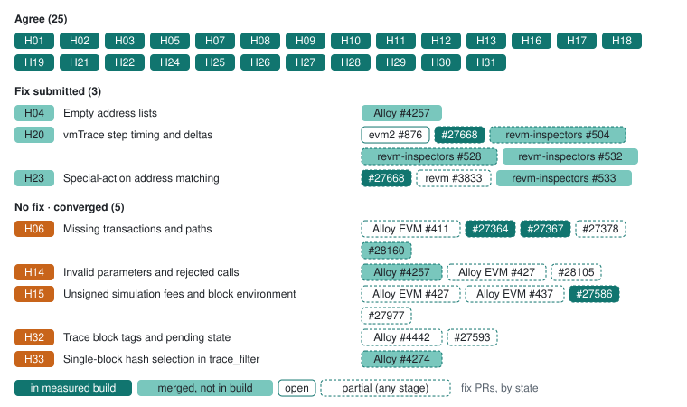

# Reth: changes to review

Reth 2.9.0 · c9a780f4 replaces revm and revm-inspectors with evm2 (#25002), whose Parity tracer carries ports of the revm-inspectors fixes, and the nightly 2.8.1 · 966010c9, one commit behind it, returns the same responses. Both agree on 25 decisions, as 2.8.1 · d763342f did, but not the same 25: evm2 reports the post-Cancun SELFDESTRUCT payload, so account deletion agrees (H26) without revm #3833, while vmTrace CALL and CREATE steps lost the forwarded gas from `cost` (H20). Reth 2.8.0 · 05ba4812, with revm-inspectors 0.44.1 (#27668), had added the reverted-CREATE results, failure labels and vmTrace fixes (H09, H20) to what 2.7.0 shipped: tree-path lookup, default filter intersection, missing-replay nulls, replay transaction hashes, the genesis reward, omitted filter bounds, the omitted trace_callMany block, new-account stateDiff markers, EIP-7702 code changes and executing initcode in vmTrace. Remaining work includes simulation fees, the evm2 vmTrace call cost, and null filter address lists (Alloy #4257, merged but not in an Alloy release that Reth takes).

[All clients](../README.md) · [Client fixes](../../docs/client-fixes.md) · [Source guide](../sources.md)

**Progress on 2.8.1 · 966010c9** (of 33 decisions): ✅ 25 agree · 🛠️ 3 fix submitted · ⚠️ 5 with no fix yet (5 on converged decisions). Upstream fix PRs: 24 merged, 11 open ([client fixes](../../docs/client-fixes.md)).

Each decision on the development build, grouped as in the [progress chart](../README.md#progress), with the client’s fix PRs ([client fixes](../../docs/client-fixes.md)), styled by stage as its legend shows: in the measured development build, merged but not in that build yet, or open, with a dashed edge when a PR covers only part of the decision.

| Tested version | Commit | Commit date (UTC) | Tested (UTC) |
| --- | --- | --- | --- |
| `2.9.0` | [`c9a780f4`](https://github.com/paradigmxyz/reth/commit/c9a780f4f23d6752ca299b104c93b7f099673c80) | 2026-10-29 | [2026-10-29](../../evidence/2026-10-29/eval/initial/manifest.json) |
| `2.8.1` | [`966010c9`](https://github.com/paradigmxyz/reth/commit/966010c905449163ef161530a5ee95ac1e0c8487) | 2026-10-28 | [2026-10-29](../../evidence/2026-10-29/eval/initial/manifest.json) |

Code links use the tested development sources (or the Geth fork). These are proposed changes for the tested builds. “Checked cases agree” refers to the linked examples, not every behavior of a method. [Test status key](../technical.md#test-status-key).

## Changes to discuss

| Behavior | 2.9.0 · c9a780f4 | 2.8.1 · 966010c9 | Proposed change |
| --- | --- | --- | --- |
| [Empty address lists](../decisions/H04.md) Treats `[]` as unrestricted in both builds and rejects only a null address list, because Alloy’s `TraceFilter` defaults the lists only when they are absent. Alloy #4257 fixes this and is merged, but no Alloy release carries it; 2.7.0 locks alloy-rpc-types-trace 2.5.0. | 🛠️ Fix submitted: [Alloy #4257](https://github.com/alloy-rs/alloy/pull/4257) [Filter both null](../cases/a/filter-both-null.md) | 🛠️ Fix submitted: [Alloy #4257](https://github.com/alloy-rs/alloy/pull/4257) [Filter both null](../cases/a/filter-both-null.md) | Take up Alloy #4257 so a null list is treated as omitted. Checked requirements: Compare address bytes: OR within each list, AND across lists by default and OR under mode union; missing/null/empty lists are unrestricted. [Address filtering](https://github.com/paradigmxyz/reth/blob/58a51b3ee3f6714ded9207b244a273c8afb592fd/crates/rpc/rpc/src/trace.rs#L370) |
| [Missing transactions and paths](../decisions/H06.md) 2.7.0 · 3d592ece and the nightly return null for a missing individual replay (#27364) and from trace_replayBlockTransactions for an unknown block, and -32001 for a filter bound beyond the head. See the linked pruning cases for unavailable-history classification. The pinned draft requires an error with -32001 for an unknown block, so the null from trace_replayBlockTransactions now differs. | ⚠️ Differs · [Alloy EVM #411](https://github.com/alloy-rs/evm/pull/411) (partial fix) · [Reth #27378](https://github.com/paradigmxyz/reth/pull/27378) (partial fix) · [Reth #28160](https://github.com/paradigmxyz/reth/pull/28160) (partial fix) [Missing block replay](../cases/a/missing-block-replay.md) | ⚠️ Differs · [Alloy EVM #411](https://github.com/alloy-rs/evm/pull/411) (partial fix) · [Reth #27378](https://github.com/paradigmxyz/reth/pull/27378) (partial fix) · [Reth #28160](https://github.com/paradigmxyz/reth/pull/28160) (partial fix) [Missing block replay](../cases/a/missing-block-replay.md) | Return -32001 for an unknown block in trace_replayBlockTransactions. Checked requirements: An unknown selected block returns an error with code -32001, never null or a result. Unavailable historical state returns an error (4444, pruned history, recommended), never a result or null. [Trace lookup](https://github.com/paradigmxyz/reth/blob/58a51b3ee3f6714ded9207b244a273c8afb592fd/crates/rpc/rpc/src/trace.rs#L218) · [Replay results](https://github.com/paradigmxyz/reth/blob/58a51b3ee3f6714ded9207b244a273c8afb592fd/crates/rpc/rpc/src/trace.rs#L195) |
| [Invalid parameters and rejected calls](../decisions/H14.md) An integer trace_get path returns null instead of invalid params. trace_filter rejects a null `mode`, `fromAddress` or `toAddress`: Alloy's `TraceFilter` defaults them only when absent. The 2026-09-26 `filter-null-fromBlock` failure came from its `"latest"` toBlock (H32), not the null; the case now names the head by number. | ⚠️ Differs · [Alloy #4257](https://github.com/alloy-rs/alloy/pull/4257) (partial fix) · [Alloy EVM #427](https://github.com/alloy-rs/evm/pull/427) (partial fix) · [Reth #28105](https://github.com/paradigmxyz/reth/pull/28105) (partial fix) [Get integer path](../cases/a/get-integer-path.md) | ⚠️ Differs · [Alloy #4257](https://github.com/alloy-rs/alloy/pull/4257) (partial fix) · [Alloy EVM #427](https://github.com/alloy-rs/evm/pull/427) (partial fix) · [Reth #28105](https://github.com/paradigmxyz/reth/pull/28105) (partial fix) [Get integer path](../cases/a/get-integer-path.md) | Reject integer path entries (-32602 recommended); callers must convert output path integers to hex quantities. Treat a null filter member as omitted. Checked requirements: Malformed input returns an error (-32602 recommended). The blob call runs at GASPRICE 2000000000, the word its CREATE2 child deploys. The blob call runs with type 3, which does not change execution, at GASPRICE 2000000000, the word its CREATE2 child deploys. Null mode, after, count and address lists are omitted, so blocks 2-5 return every record. [Signed transaction replay](https://github.com/paradigmxyz/reth/blob/58a51b3ee3f6714ded9207b244a273c8afb592fd/crates/rpc/rpc/src/trace.rs#L121) · [Call simulation](https://github.com/paradigmxyz/reth/blob/58a51b3ee3f6714ded9207b244a273c8afb592fd/crates/rpc/rpc/src/trace.rs#L97) |
| [Unsigned simulation fees and block environment](../decisions/H15.md) Both methods use BASEFEE 0 for explicit zero fees and both omit priced upfront gas payment: the shared call environment sets `disable_fee_charge`, added for OP operator fees (#18634, reverted in #18645, re-added in #19073), which also skips the funding check. Both accept underpriced legacy calls and reject underpriced typed caps; a tip-only request is priced at the base fee. Method consistency agrees in 200 defined-policy pairs per build; two underfunded-value families have unclassified EVM failures. Independent priced accounting/funding checks still differ. On blob calls, an omitted `maxFeePerBlobGas` runs at the selected BLOBBASEFEE and an explicit zero is rejected (-32003). | ⚠️ Differs · [Alloy EVM #427](https://github.com/alloy-rs/evm/pull/427) (partial fix) · [Alloy EVM #437](https://github.com/alloy-rs/evm/pull/437) (partial fix) · [Reth #27977](https://github.com/paradigmxyz/reth/pull/27977) (partial fix) 8 blocked cases: eth_call: funds execution halt; trace_call: No root trace was returned to distinguish an execution halt from empty output. [Many storage write read](../cases/a/many-storage-write-read.md) | ⚠️ Differs · [Alloy EVM #427](https://github.com/alloy-rs/evm/pull/427) (partial fix) · [Alloy EVM #437](https://github.com/alloy-rs/evm/pull/437) (partial fix) · [Reth #27977](https://github.com/paradigmxyz/reth/pull/27977) (partial fix) 8 blocked cases: eth_call: funds execution halt; trace_call: No root trace was returned to distinguish an execution halt from empty output. [Many storage write read](../cases/a/many-storage-write-read.md) | Keep zero-fee compatibility. Default an omitted fee cap to zero, so a zero tip-only request runs free and a positive one is rejected as tip above cap. Reject positive legacy prices below base fee, enforce funding and simulate payment/refunds/tips during execution and later calls. Agreement with eth_call is assessed separately from this accounting requirement. Whether the L1 effect of `disable_fee_charge` is intended is an open question to Reth; complying also changes its eth_call. Asked in [reth#27476](https://github.com/paradigmxyz/reth/issues/27476) whether skipping fee charging and funding checks on L1 is intended. Run a blob call with an omitted or zero `maxFeePerBlobGas` at BLOBBASEFEE 0 with no blob fee, accepting the explicit zero. [Call simulation](https://github.com/paradigmxyz/reth/blob/58a51b3ee3f6714ded9207b244a273c8afb592fd/crates/rpc/rpc/src/trace.rs#L97) |
| [vmTrace step timing and deltas](../decisions/H20.md) 2.9.0 · c9a780f4 and the nightly 966010c9 run evm2, whose vmTrace reports a CALL or CREATE `cost` without the gas forwarded to the child: the replay-tree root CALL costs 9,396 where Erigon, Nethermind, Anvil and the Geth draft report 71,624, with the same `ex.used`. A call or creation that fails its precheck also omits the forwarded gas. The other revm-inspectors 0.44.1 fixes carried over. | 🛠️ Fix submitted: [evm2 #876](https://github.com/alloy-rs/evm2/pull/876) · [revm-inspectors #504](https://github.com/paradigmxyz/revm-inspectors/pull/504) (partial fix) · [revm-inspectors #528](https://github.com/paradigmxyz/revm-inspectors/pull/528) (partial fix) · [revm-inspectors #532](https://github.com/paradigmxyz/revm-inspectors/pull/532) [Call siblings revert ok](../cases/a/call-siblings-revert-ok.md) | 🛠️ Fix submitted: [evm2 #876](https://github.com/alloy-rs/evm2/pull/876) · [revm-inspectors #504](https://github.com/paradigmxyz/revm-inspectors/pull/504) (partial fix) · [revm-inspectors #528](https://github.com/paradigmxyz/revm-inspectors/pull/528) (partial fix) · [revm-inspectors #532](https://github.com/paradigmxyz/revm-inspectors/pull/532) [Call siblings revert ok](../cases/a/call-siblings-revert-ok.md) | Include the forwarded gas (63/64-capped for calls, all but 1/64 for creations) in the evm2 inspector's CALL and CREATE `cost`, also after a failed precheck. Checked requirements: At every VM depth, every pc lies inside the code, PUSH matches bytecode, each step deducts its cost and a call or creation also receives its child leftover or, entering no frame, includes the gas it forwarded, subtraces appear only on calls and creations, MLOAD mem is its loaded word, call mem is the output window or the copied return data, and RETURN/REVERT report no mem. [VM trace builder (revm-inspectors 0.43.0)](https://github.com/paradigmxyz/revm-inspectors/blob/453c67d7ccdf51327c9e7687ac6ba0b8651e7f87/src/tracing/builder/parity.rs#L317) |
| [Trace block tags and pending state](../decisions/H32.md) trace_filter rejects earliest, safe and pending with -32602, although numeric bounds work: Alloy’s `TraceFilter` types the bounds as quantities, so even "latest" is rejected. Explicit pending call simulations return NUMBER 49, and with a transaction pooled (`pending` corpus) `trace_block` and `trace_replayBlockTransactions` at pending trace a locally built block 49 holding it, under its non-canonical hash. | ⚠️ Differs · [Alloy #4442](https://github.com/alloy-rs/alloy/pull/4442) (partial fix) · [Reth #27593](https://github.com/paradigmxyz/reth/pull/27593) (partial fix) [Filter earliest](../cases/h30/filter-earliest.md) | ⚠️ Differs · [Alloy #4442](https://github.com/alloy-rs/alloy/pull/4442) (partial fix) · [Reth #27593](https://github.com/paradigmxyz/reth/pull/27593) (partial fix) [Filter earliest](../cases/h30/filter-earliest.md) | Accept latest, earliest, safe and finalized filter bounds (an Alloy `TraceFilter` change), with earliest as the lowest available block, and keep rejecting pending bounds. Pending block traces are allowed; how their records are localized is still open. [Filter block-selector type](https://github.com/paradigmxyz/reth/blob/58a51b3ee3f6714ded9207b244a273c8afb592fd/crates/rpc/rpc/src/trace.rs#L372) · [Batched call block default](https://github.com/paradigmxyz/reth/blob/58a51b3ee3f6714ded9207b244a273c8afb592fd/crates/rpc/rpc/src/trace.rs#L155) |
| [Single-block hash selection in trace_filter](../decisions/H33.md) Both builds reject every non-null `blockHash` with -32602 (Alloy’s `TraceFilter` denies unknown fields), so they pass the error cases, including the reorg phases where the hash is unknown or noncanonical, and differ wherever block 2’s records are expected. A null `blockHash` beside numeric bounds is rejected too. | ⚠️ Differs · [Alloy #4274](https://github.com/alloy-rs/alloy/pull/4274) (partial fix) [Filter blockhash](../cases/h30/filter-blockhash.md) | ⚠️ Differs · [Alloy #4274](https://github.com/alloy-rs/alloy/pull/4274) (partial fix) [Filter blockhash](../cases/h30/filter-blockhash.md) | Add `blockHash` to Alloy’s `TraceFilter` and map it to a single-block range over the canonical block in one chain view, erroring for an unknown or noncanonical hash; treat a null member as omitted. [Address filtering](https://github.com/paradigmxyz/reth/blob/58a51b3ee3f6714ded9207b244a273c8afb592fd/crates/rpc/rpc/src/trace.rs#L370) |

## Open policy observations

These results record behavior whose policy is unresolved. Passing a checked part of a topic does not settle the remaining choices.

| Build | Decision | Observed | Example |
| --- | --- | --- | --- |
| 2.9.0 · c9a780f4 | [Raw-transaction block argument](../decisions/H12.md) | 6 extension cases. Selector block 0x0 by number: honored: the block 0x0 post-state, sender nonce 0. Selector latest: honored: the latest (block 0x30) post-state in the head (block 0x30) environment. Selector block 0x19 by number: honored: the block 0x19 post-state in the block 0x19 environment. Selector block 0x19 by hash: honored: the block 0x19 post-state in the block 0x19 environment. Selector block 0x19 as an EIP-1898 object: honored: the block 0x19 post-state in the block 0x19 environment. Selector pending: honored: the latest (block 0x30) post-state in the pending block 0x31 environment. | [Raw valid](../cases/initial/raw-valid.md) · [Raw state hash](../cases/raw-selector/raw-state-hash.md) |
| 2.8.1 · 966010c9 | [Raw-transaction block argument](../decisions/H12.md) | 6 extension cases. Selector block 0x0 by number: honored: the block 0x0 post-state, sender nonce 0. Selector latest: honored: the latest (block 0x30) post-state in the head (block 0x30) environment. Selector block 0x19 by number: honored: the block 0x19 post-state in the block 0x19 environment. Selector block 0x19 by hash: honored: the block 0x19 post-state in the block 0x19 environment. Selector block 0x19 as an EIP-1898 object: honored: the block 0x19 post-state in the block 0x19 environment. Selector pending: honored: the latest (block 0x30) post-state in the pending block 0x31 environment. | [Raw valid](../cases/initial/raw-valid.md) · [Raw state hash](../cases/raw-selector/raw-state-hash.md) |

Result-shape differences are recorded on the [case pages](../technical.md#result-shape-checks); schema validity is separate from semantic coverage.

## Assessment gaps

| Decision | Build | Reason | Example |
| --- | --- | --- | --- |
| [Special-action address matching](../decisions/H23.md) | 2.9.0 · c9a780f4 | 3 blocked cases: The H04 list semantics differ, so the special-action records cannot be judged separately. 🛠️ Fix submitted: [revm #3833](https://github.com/bluealloy/revm/pull/3833) (partial fix) · [revm-inspectors #533](https://github.com/paradigmxyz/revm-inspectors/pull/533) | [Filter both null](../cases/a/filter-both-null.md) · [Filter from null](../cases/a/filter-from-null.md) |
| [Special-action address matching](../decisions/H23.md) | 2.8.1 · 966010c9 | 3 blocked cases: The H04 list semantics differ, so the special-action records cannot be judged separately. 🛠️ Fix submitted: [revm #3833](https://github.com/bluealloy/revm/pull/3833) (partial fix) · [revm-inspectors #533](https://github.com/paradigmxyz/revm-inspectors/pull/533) | [Filter both null](../cases/a/filter-both-null.md) · [Filter from null](../cases/a/filter-from-null.md) |

✅ Behaviors with no difference in the checked cases

| Behavior | Examples |
| --- | --- |
| [trace_get selector and return shape](../decisions/H02.md) | [_reference/block/0x30](../cases/a/_reference/block/0x30.md) · [Block 2](../cases/a/block-2.md) |
| [Filter composition and mode](../decisions/H03.md) | [Filter all](../cases/a/filter-all.md) · [Filter both unknown mode](../cases/a/filter-both-unknown-mode.md) |
| [Post-merge reward records](../decisions/H05.md) | [_reference/block/0x30](../cases/a/_reference/block/0x30.md) · [Block 2](../cases/a/block-2.md) |
| [Replay transactionHash field](../decisions/H07.md) | [Replay 35](../cases/forks/replay-35.md) · [Replay 36](../cases/forks/replay-36.md) |
| [Empty output and unrequested components](../decisions/H08.md) | [Auth clear](../cases/a/auth-clear.md) · [Auth replace](../cases/a/auth-replace.md) |
| [Failed frame results and error labels](../decisions/H09.md) | [Auth replace](../cases/a/auth-replace.md) · [Auth set revert](../cases/a/auth-set-revert.md) |
| [Creation result field names](../decisions/H10.md) | [Call mixed create](../cases/a/call-mixed-create.md) · [Model empty runtime](../cases/coverage/model-empty-runtime.md) |
| [Empty trace-type selection](../decisions/H11.md) | [Empty types](../cases/a/empty-types.md) · [Call empty types](../cases/initial/call-empty-types.md) |
| [Raw-transaction block argument](../decisions/H12.md) | [Raw valid current nonce](../cases/initial/raw-valid-current-nonce.md) · [Raw state default](../cases/raw-selector/raw-state-default.md) |
| [Signed transaction execution validity](../decisions/H13.md) | [Raw below basefee](../cases/a/raw-below-basefee.md) · [Raw insufficient funds](../cases/a/raw-insufficient-funds.md) |
| [Fee accounting and sequential state diffs](../decisions/H16.md) | [Many storage write read](../cases/a/many-storage-write-read.md) · [Many storage write revert read](../cases/a/many-storage-write-revert-read.md) |
| [New-account stateDiff encoding](../decisions/H17.md) | [Prefunded empty](../cases/a/prefunded-empty.md) · [Model empty runtime](../cases/coverage/model-empty-runtime.md) |
| [EIP-7702 code changes in stateDiff](../decisions/H18.md) | [Auth clear](../cases/a/auth-clear.md) · [Auth replace](../cases/a/auth-replace.md) |
| [vmTrace executing bytecode](../decisions/H19.md) | [Auth clear](../cases/a/auth-clear.md) · [Auth replace](../cases/a/auth-replace.md) |
| [vmTrace numeric and optional metadata encoding](../decisions/H21.md) | [Auth clear](../cases/a/auth-clear.md) · [Auth replace](../cases/a/auth-replace.md) |
| [Precompile return bytes](../decisions/H22.md) | [Call identity](../cases/initial/call-identity.md) |
| [Sibling failure isolation](../decisions/H24.md) | [Call siblings revert ok](../cases/a/call-siblings-revert-ok.md) · [Nested call outer0 value1 failed](../cases/precompile-values/nested-call-outer0-value1-failed.md) |
| [Well-formed errors for rejected raw transactions](../decisions/H25.md) | [Auth clear](../cases/a/auth-clear.md) · [Auth replace](../cases/a/auth-replace.md) |
| [Account deletion across Cancun](../decisions/H26.md) | [Destroy trace 55](../cases/fork-followup/destroy-trace-55.md) · [Destroy trace 56](../cases/fork-followup/destroy-trace-56.md) |
| [Filter execution across fork boundaries](../decisions/H27.md) | [Filter two blocks](../cases/a/filter-two-blocks.md) · [Filter 35](../cases/forks/filter-35.md) |
| [Historical state at system-operation boundaries](../decisions/H28.md) | [Beacon call 55](../cases/fork-followup/beacon-call-55.md) · [Beacon call 56](../cases/fork-followup/beacon-call-56.md) |
| [Precompile call-frame inclusion](../decisions/H29.md) | [Block 2](../cases/a/block-2.md) · [Filter all](../cases/a/filter-all.md) |
| [Omitted trace_filter range bounds](../decisions/H30.md) | [Filter no bounds](../cases/h30/filter-no-bounds.md) · [Filter to 2 implicit from](../cases/h30/filter-to-2-implicit-from.md) |
| [Omitted trace_callMany block](../decisions/H31.md) | [Call number default](../cases/h30/call-number-default.md) · [Call number latest](../cases/h30/call-number-latest.md) |

[Method availability](../decisions/H01.md) · [All decisions](../../decisions/README.md)

For setup gaps, exact run inventories and reproduction, see the [technical appendix](../technical.md).
